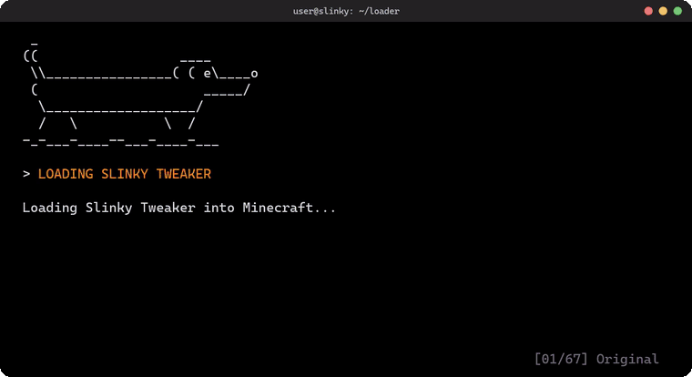

<h1>Slinky Tweaker</h1>

Tweaker for Slinky, adding extra commonly requested features.

<h2>Features</h2>

<table align="center">
  <tr>
    <td align="center"><b>Auto Ladder</b></td>
    <td align="center"><b>Bed Plates</b></td>
    <td align="center"><b>Displace Arrow</b></td>
    <td align="center"><b>HUD Editor</b></td>
  </tr>
  <tr>
    <td align="center"><b>Hide Modules</b></td>
    <td align="center"><b>Mod Overlay Styling</b></td>
    <td align="center"><b>Custom Notification Name</b></td>
    <td align="center"><b>Timer Reset on Input</b></td>
  </tr>
  <tr>
    <td align="center"><b>Removal of Slider value limits</b></td>
    <td align="center"><b>Loader Animations</b></td>
  </tr>
</table>

<h2>Downloading</h2>

Builds are created automatically with GitHub Actions. Click <a href="https://github.com/Tewxx/SlinkyTweaker/actions"><b>Actions</b></a> to download.

<h2>Building</h2>

GitHub Actions builds the EXE directly from this project's source code. You can review the source and <a href=".github/workflows/build.yml">build workflow</a> yourself to check what you're running and see how it's built.

<h2>Info</h2>

There are no automatic updates for the tweaker so if something breaks look back here for updated version. Slinky Tweaker does however auto download latest version of Slinky beta from Slinky's servers.

